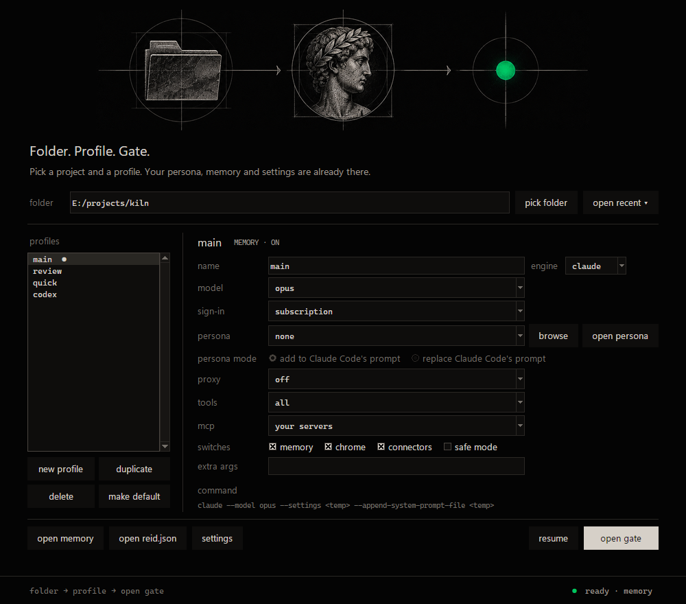

<p align="center">
  
</p>

<h1 align="center">Reidcc</h1>

<p align="center">
  <strong>Folder. Profile. Gate.</strong><br />
  Only the essentials, all in sight.
</p>

---

Reidcc is a launcher built on Claude Code, Codex and OpenCode for people who want things simple. Pick a folder and a profile and you are coding in seconds, with your persona, long-term memory and settings already set up. Every session shows where it is, which profile is running, and how much context and limit you have used. Its request proxy (`proxy`) lives here too; its memory system, ACA, is a plugin with its own repo.

**Status:** Windows 10 and 11 · **beta** (everything is) · installer and self-updates from
[Releases](https://github.com/AIden6464-AI/reidcc/releases/latest) · **docs:** [aiden6464-ai.github.io/reidcc](https://aiden6464-ai.github.io/reidcc/) (built from `site\`).

**Branches:** `dev` (this one) has everything: specs, vision, the Python original, proxy, tests. ACA moved to its own repo.
[`main`](https://github.com/AIden6464-AI/reidcc/tree/main) is the user-facing subset, rebuilt from
`dev` on every push (`.github/workflows/publish-main.yml`, README from `.github/main/README.md`). Work and
pull requests go to `dev`; releases are tagged on `main`.

<p align="center">
  
</p>

---

## Install

1. You need [Claude Code](https://docs.anthropic.com/en/docs/claude-code) installed and signed in once
   (`claude` on your PATH). Codex is optional.
2. Download `Reidcc_<version>_x64-setup.exe` from the
   [latest release](https://github.com/AIden6464-AI/reidcc/releases/latest) and run it. No admin needed.
   It isn't code-signed yet, so SmartScreen may say *Windows protected your PC*: *More info* → *Run anyway*.
3. Open **Reidcc** from the Start Menu or desktop, or type `reid` in a new terminal.

| | Where |
|---|---|
| The program (replaced on every update) | `%LOCALAPPDATA%\Reidcc` |
| Your profiles, memory, personas, keys (made on first launch) | `%USERPROFILE%\Reidcc` |

**Updates:** when a newer release is out, the footer shows `update <version> · install`. Click it
once your sessions have finished. In a terminal: `reid --update`. Nothing installs unless you ask.
**Offline:** Reidcc itself needs no internet. It goes online only to download the installer and for
updates (a check at start and every 6 hours; offline, it just skips it). Your profiles, memory and
personas stay on your PC. The sessions it opens (Claude Code, Codex) still need their own connection.
**Uninstall:** Settings → Apps → Reidcc. Your folder is kept.

## Build from source

You need [Rust](https://rustup.rs) (stable), [Node.js](https://nodejs.org) 22, and
[Claude Code](https://docs.anthropic.com/en/docs/claude-code) installed and signed in once (`claude` on your PATH).
Codex is optional. The window uses WebView2, which ships with Windows 11 and current Windows 10.

```powershell
git clone https://github.com/AIden6464-AI/reidcc
cd reidcc\rs\ui; npm ci; npm run build        # the window's UI
cd ..; cargo build --release                  # reid.exe (terminal) + Reidcc.exe (window)

# where your profiles, memory and personas live (any folder works)
mkdir "$env:USERPROFILE\Reidcc"; setx REIDCC_HOME "$env:USERPROFILE\Reidcc"
```

Open a new terminal (so it sees `REIDCC_HOME`), then run `rs\target\release\Reidcc.exe` for the
window or `rs\target\release\reid.exe` for the terminal launcher. The first run writes `reid.json`
there with one profile, `main` (Opus, memory on). Pick a folder, then **open gate**.

- **Without `REIDCC_HOME`**, Reidcc uses the first folder above the exe that holds a `reid.json`.
  Put one in the clone's root to keep everything in the clone, which is how the author runs it. With neither,
  it uses `%USERPROFILE%\Reidcc`, the same folder an installed copy uses.
- **Tests:** `cargo test --workspace` in `rs\` (CI runs the same on every push).

---

## Layout

Items marked *local* are created on your machine and never committed (see `.gitignore`).

```text
reidcc\
├─ app\               local: the Python original's build (the author's older setup)
├─ python\            the Python original, which rs\ was ported from 1:1 (parity tests still read it)
│  ├─ reid.py         TUI, CLI and engine
│  ├─ reid_gui.py     the app window
│  └─ build\          build.ps1 + spec + make_assets.py (rebuild app\ after editing the source)
├─ rs\                the app: reid.exe (CLI + TUI) and Reidcc.exe (window), what the installer ships since 0.2.0
│                     (core\, cli\, app\ = Tauri, ui\ = the window's TypeScript, tests\ = acceptance flows)
├─ vision\            how Reidcc looks and talks: palette, design & motion, voice, branding\ art
│  ├─ SPEC-vision-v1.md  vision version 1: sizes, session windows, snap, headless, rigs (session window and snap betas built)
│  ├─ Spec\           proxy, gate (built), tui (proposed), codex-opencode (both built),
│                     codex-signin-persona (built), codex-proxy (built), rust-rewrite (stage 0 built),
│                     rust-tui-gui (1:1 TUI + GUI in Rust, built, shipping since 0.2.0), app,
│                     github-repo (installer + updater, built), unified-interface (Step 0 and Milestones 1,
│                     2, 2B, 2C built on dev), plugins, github-pages (website, built in site\;
│                     the mock it was ported from is in Spec\github-pages\mock\)
│  └─ ads\            one post per subreddit, with the posting rules and order
├─ site\             the website: VitePress landing page + docs, deployed by .github\workflows\pages.yml
├─ assets\            banner.png, gate frames (gate_*.png) and TUI half-block gate frames (tui\gate_*.json.gz)
├─ docs\              README images
├─ reidcc.ico         app icon: the engraved RC logo (vision\branding\), cut by make_assets.py
├─ reid.json          local: profiles (engine, model, auth, persona, memory, proxy, tools, mcp, switches)
├─ reid_state.json    local: last session + recent folders (written by reid)
├─ reidcc_memory.md   local: long-term memory injected into sessions with memory on
├─ personas\          persona prompts used by profiles (only plain.md is committed)
├─ json\              local: Claude Code settings files (API mode); THESE HOLD API KEYS
├─ codex\             local: Codex sign-in files (*.toml, may hold keys) + prompts\ (persona + memory per launch)
├─ mds\               local: other persona / prompt drafts
├─ aca\               local, untracked: working copy of the ACA repo (its own repo now)
├─ proxy\             mitmproxy add-ons + lean launchers (slim, ultra-slim, mini, stripped)
├─ legacy\            local: old GUI split attempt, config backups
├─ LICENSE.md         PolyForm Noncommercial 1.0.0 (see License below)
└─ .github\workflows\ ci.yml: UI build + Rust tests on Windows
```

---

## reid: app or tool, auto-detected

<p align="center">
  
</p>

- **Typed in a terminal** (`reid`) → **TUI** in that terminal.
- **Started as an app** (Start Menu or desktop `Reidcc`, or `Reidcc.exe`) → **GUI** window.
- **Any arguments** → CLI. `reid --gui` / `reid --tui` force one (from a terminal, `--gui` detaches the window).
- **Rebuilding:** see [Build from source](#build-from-source). The Python original rebuilds with `python\build\build.ps1` into `app\`.

### One screen and the gate

The flow is `folder → profile → open gate` in both the GUI and the TUI. The profile list and every field of the selected profile stay visible on one screen, and changes save as you make them.

- **Keys (GUI):** `Enter` on the profile list opens the gate · `Ctrl+Enter` opens the gate from anywhere · `Ctrl+O` picks a folder · `Ctrl+R` resumes · `Esc` clears a message.
- **Keys (TUI):** `↵ open gate · r resume · e edit · n new · x delete · d default · w pick folder · m memory · 1–9 jump · q quit`
- **The gate:** hovering or focusing `open gate` / `resume` shows a faint blueprint ghost of the gate over the launcher. Pressing it starts the session while the gate opens, in a Reidcc session window (the Python original opened Windows Terminal). Any key or click skips the animation.

<p align="center">
  
</p>

### CLI commands

```text
reid                    Open the TUI in a terminal, or the GUI when launched as an app
reid <profile> [args]   Launch a profile in the current folder; extra args go to its engine
reid -c / reid "do X"   Anything that isn't a profile goes to the default profile's engine
reid --resume [profile] Resume the last session (Claude Code, Codex or OpenCode), with that profile or its own
reid --resume <profile> --id ID   Resume that session, in this folder
reid --chat [profile]   Chat with Claude Code, Codex or OpenCode in this folder, in the terminal
reid --stream <profile> [--read-only] [--resume ID] [--with JSON] [--switch-from PROFILE] PROMPT
                        Run one headless turn and print its events as JSON lines
reid --dry [-v] [profile]   Show the exact command and proxy plan (-v: the prompt and settings files too)
reid -l                 List all profiles and their summaries
reid --tui / --gui      Force the TUI or GUI
reid --edit / --mem     Open reid.json / reidcc_memory.md
reid --version          Show the Reidcc version
reid --update           Install the latest Reidcc (installed copies only)
reid -h                 Full CLI help
```

---

## Engines

A profile selects its engine (`claude`, `codex` or `opencode`) on the `name` row. Profiles without an `engine` field default to `claude`. Unsupported fields stay visible and greyed out so nothing is hidden.

### Claude Code

- **Sign-in:** default Claude subscription, or a `json\*.json` settings file (keys stay in the file).
- **Persona and memory:** attach any Markdown persona (`add to Claude Code's prompt` or `replace Claude Code's prompt`) and toggle `reidcc_memory.md`.
- **Statusline:** every session gets `~/folder · PROFILE · MAIN · PERSONA · X   context 42% · limit 61%` (`reid --statusline`; `limit` appears on a subscription after the first reply). Turn it off per profile with `"statusline": false`.
- **Return and resume:** `/reid` inside Claude returns to the TUI with the conversation kept (`r` resumes it with any profile); `/exit` leaves.
- **Lean profiles:** `slim`, `ultra`, `mini`, `mini-slim`, `mini-mcp`, `plain`, `capture`. Proxy profiles start a private `mitmproxy` per session (see `vision\Spec\SPEC-proxy.md`).
  Measured (one-word prompt): `baseline 26,980` input tokens · `slim 22,509` · `ultra 11,659` · `mini 5,217` · `mini-slim 3,920` · `plain 772`.

### Codex

- **Native launch:** resolves the vendored `codex.exe` directly instead of `.cmd` shims, so paths with spaces, `&`, `%` or `^` work cleanly.
- **Sign-in:** uses your terminal `codex login` (status checked in the background: `ChatGPT`, `API key`, or `not signed in`) or a `codex\*.toml` provider file (for LM Studio, OpenRouter, or other APIs).
- **Persona and memory:** uses the same persona files and `reidcc_memory.md` (`add to Codex's prompt` or `replace Codex's prompt`). Generated files live in `codex\prompts\<profile>.md`; nothing is written to `~/.codex`.
- **Session flow:** Codex statusline (`model · folder · context · 5h · weekly`), `REIDCC · codex · <profile>` tab title, and `/quit` returns to the Reidcc TUI.
- **Resume:** works both ways, like Claude. Reidcc finds the Codex thread while the session runs, and `resume` reopens it (`codex resume <id>`, or `--last` when the id isn't known yet).
- **Proxy:** per-session `capture`, `slim` and `ultra` add-ons for Codex traffic (`proxy\codex_*_addon.py`; `optimize` is Claude-only). Measured on codex-cli 0.172.0: `slim` −12.0%, `ultra` −13.1% input tokens, but no server cache on a fresh slimmed thread (numbers in `site\docs\proxy.md`). See `vision\Spec\SPEC-codex-proxy.md`.

### OpenCode

- **Native launch:** the vendored `opencode.exe` (never the npm `.cmd` shim), always `--standalone`, so a private server reads the per-launch config layer (`OPENCODE_CONFIG_CONTENT`) and your own `~/.config/opencode` is never touched.
- **Sign-in and model:** OpenCode's own providers, or an `opencode\*.json` config file laid over them; the model list comes from `opencode models` and effort is the model's variant.
- **Persona and memory:** the same persona files and `reidcc_memory.md`, in `opencode\prompts\<profile>.md` (`add to` OpenCode's prompt, or `replace` it).
- **Sessions and resume:** session windows and `reid --stream` use `--session <id>`, and Reidcc names a session after its first ask in OpenCode's own list.
- **Chat:** edits turns edit files without a shell; read-only turns only read and search. No proxy, tools or MCP rows yet (see `vision\Spec\SPEC-codex-opencode.md` and `SPEC-0.2.6.md`).

---

## Wired up outside this folder

The installer (through `reid --install`, undone by `reid --uninstall`) adds the program folder to
your user PATH, Start Menu and desktop shortcuts, and the `/reid` slash command if `~\.claude`
exists and has none yet. The author's older Python setup adds:

- **User PATH** includes this folder's `app\` (`reid`, `reidcc`; extensionless shims there are for Git Bash).
- **`~\.claude\commands\reid.md`** (the `/reid` slash command).
- **Start Menu** `Reidcc.lnk` → `app\Reidcc.exe`.

---

## aca

Long-term cognitive memory server (separate from `reidcc_memory.md`; Reidcc does not read ACA directly yet).

ACA now has its own repo, [AIden6464-AI/aca](https://github.com/AIden6464-AI/aca), and ships as a Claude Code plugin from the [reidcc marketplace](https://github.com/AIden6464-AI/reidcc-plugins) (`/plugin install aca@reidcc`; see `vision/Spec/SPEC-plugins.md`). The `aca\` folder here is a local working copy that git no longer tracks: the hooks below still point at it until the move to the plugin (spec Part 4e).

- **Start:** `aca\start.bat` (prints the server window; closing it stops the server).
- **Health:** `http://127.0.0.1:8420/health` · **Inspector:** `http://127.0.0.1:8420/inspector`

Wired up outside this folder (paths point at this folder's `aca\`):
- `~\.claude\settings.json`: `UserPromptSubmit`, `PostToolUse(Bash)`, `PostToolUseFailure(Bash)` hooks run `aca\integrations\claude_code\aca_hook.py`.
- `~\.claude.json`: user MCP server `aca` runs `aca\integrations\claude_code\aca_mcp.py`.
- `~\.aca\claude_code.key`: the write key the hook and MCP server use.

If this folder moves, update those three places.

---

## proxy

Used by `reid` profiles via the `proxy` field (`slim`, `ultra`, `optimize`, `capture`, or combinations). Each session starts a hidden `mitmdump` on an OS-assigned free port inside a kill-on-close Job Object and logs to `proxy\logs\<profile>.log`.

- The `claude-*.cmd` launchers still work standalone but are superseded by profiles. See `proxy\README.md`.
- **Venv:** `proxy\.venv` (mitmproxy).
- **Tests:** `proxy\.venv\Scripts\python.exe -m pytest proxy\tests -q`
- **Caveat:** `slim` and `ultra` rewrite requests and can break on a Claude Code update. `mini`, `mini-mcp`, `plain`, `claude-mini-native.cmd` and `prompt-remover\` use official flags only.

---

## Rust app & roadmap

Reidcc runs on Rust since 0.2.0 (`rs\`: Tauri 2 + TypeScript + `portable-pty` + `xterm.js`), with the same data files and `mitmproxy` add-ons as the Python original. Build with `cargo build --release` in `rs\`. The acceptance flows live in `rs\tests\` (`python rs\tests\<flow>.py`; the GUI flows overwrite the shots in `session_shots\`, `gui_shots\` and `dock_shots\`).

| Stage | Status | Details |
|---|---|---|
| **Stage 0 · core + CLI** | Built | `rs\core`, `rs\cli` (`reid.exe`, 153/154 byte-identical parity with Python) |
| **Stage 1 · 1:1 TUI + GUI** | Built, shipping since 0.2.0 | 48/48 TUI parity, 175/175 GUI `reid.json` parity (`rs\target\release\Reidcc.exe`) |
| **Stage 2 · session windows** | Beta built in Rust | Embedded ConPTY + xterm.js window with Telemetry Bar and drag shimmer |
| **Stage 3 · snap and fuse** | Beta built in Rust | Drag session windows together for a shared frame of up to four live panes. Drag the frame header to move them together or a pane header to pull it out. |
| **Vision v1 · sizes** | Built in Rust | The launcher has three sizes: `main` (`Alt+1`), `medium` (the form, drag it narrow) and `small` (`Alt+2`), plus the `pod` (`Alt+3`, or drag it small): a capsule with one slot per running session. To do: a key for medium, and the pod as a toggle |
| **Vision v1 · headless, rigs** | Proposed | Headless run strips, orchestrator rigs, TUI redesign |
| **Unified interface · Step 0** | Built on `dev` | Codex resume both ways (`vision\Spec\SPEC-unified-interface.md`) |
| **Unified interface · Milestone 1** | Built on `dev` (core + CLI) | `reid --stream`: one headless turn on Claude or Codex as JSON-line events (started, text, tool call, usage, done, error); context stays unknown when the engine doesn't report it. **Read-only** uses each CLI's own flags (Claude loses its write tools; Codex runs in a read-only sandbox). **Switch** writes `.reid\handoff.md` (changed files, diff stat, optional tests and note) and passes it to the next engine. **Locks** are held by the OS and freed if a process dies: one window per session; session windows share a folder, a headless write turn needs it alone. Acceptance test 30/30 |
| **Unified interface · Milestone 2** | GUI and TUI built on `dev` | **open chat** (beside resume) opens a chat window on the launcher's folder and profile: one composer over Claude Code and Codex, each turn a `reid --stream` child. It streams text and tool lines, `stop` kills the turn, and after a write turn a collapsible **changed** block (from git) opens to each file's diff. Picking another profile turns `send` into `switch → <engine>`, with a `.reid/handoff.md` divider. **open terminal** resumes that session in a session window. Lock refusals show in the composer (`focus window`, `send read-only`). Acceptance test 41/41. In the TUI, `c` (or `reid --chat [profile]`) opens the same chat in text: tab picks the profile, ctrl+r read-only, ctrl+t open terminal, ctrl+d the diff. Acceptance test 40/40 |
| **Unified interface · Milestone 2C** | Built on `dev` | Model, effort, MCP servers and plugins. In the launcher, **tune** beside the model sets a profile's effort and turns single MCP servers and plugins off or on (profile keys `effort`, `mcp_off`, `plugins`). In a chat, **tune** (TUI: ctrl+e) changes model, effort, servers and plugins for that chat's turns only; reid.json stays as it is |
| **0.2.5 beta polish** | Released 2026-11-27 | Turns read `edits` or `read-only`, and the composer says what the next turn may do before you send (`edits · no shell` for Claude, `edits · shell` for Codex). Three or more tool lines in a row fold into one (`ran N commands ›`). Context and cost show only when the engine reports them. The chat column caps at 720px, centred. `--text3` is `#7F7A73`, clearing 4.5:1 contrast |
| **0.2.6 beta** | Release candidate on `dev` | **OpenCode** is the third engine: session windows, chat, `reid --stream`, resume, persona and memory, model and effort, read-only through its own permissions. **Switching** engines in a chat now carries the whole conversation into a session of the next engine, tool calls with their output's end; when an engine won't take or resume it, the chat goes as text and says so |

<p align="center">
  
</p>

---

## Design language

- **Ground:** `#040404` canvas, `#0E0D0C` surface 1, `#171513` surface 2, `#292723` stone dark, `1px` `#2A2724` hairlines.
- **Type:** bone hierarchy (`#D6D0C8` / `#9F978E` / `#7F7A73`), neo-grotesque sans for UI, monospace with `tabular-nums` on all meters, diffs and timers.
- **Signals:** one emerald (`#00C463`) for ready and active; bronze (`#C99A45`) for loading and 75–89% context; oxide (`#C0584B`) for 90%+ context, limits and errors.
- **Motion:** `cubic-bezier(0.16, 1, 0.3, 1)`, zero bounce, `240ms` per-step ceiling.

---

## License

Reidcc is source-available under the [PolyForm Noncommercial License 1.0.0](LICENSE.md).

- **Free for people:** use it, change it, fork it and share your changes, for personal use, hobby
  projects, study, research, and noncommercial organizations (charities, schools, public bodies).
- **Credit:** every copy and fork keeps the `Required Notice:` line from [LICENSE.md](LICENSE.md).
- **Companies and paid work** (including client work) need a commercial license. Open an issue
  titled `commercial license` to talk terms.
- **Name and art:** the Reidcc name, the RC logo and the art in `vision/branding/` and `assets/` are
  not under the license. Copies of Reidcc may include them unchanged; a fork under another name
  uses its own.
- **Contributing:** by sending a pull request, you agree that your contribution is licensed under
  these terms, and that Reid may also include it in Reidcc's commercial licenses.

---

<p align="center">
  <br />
  <code>Reidcc · built on Claude Code, Codex and OpenCode · only the essentials</code>
</p>
