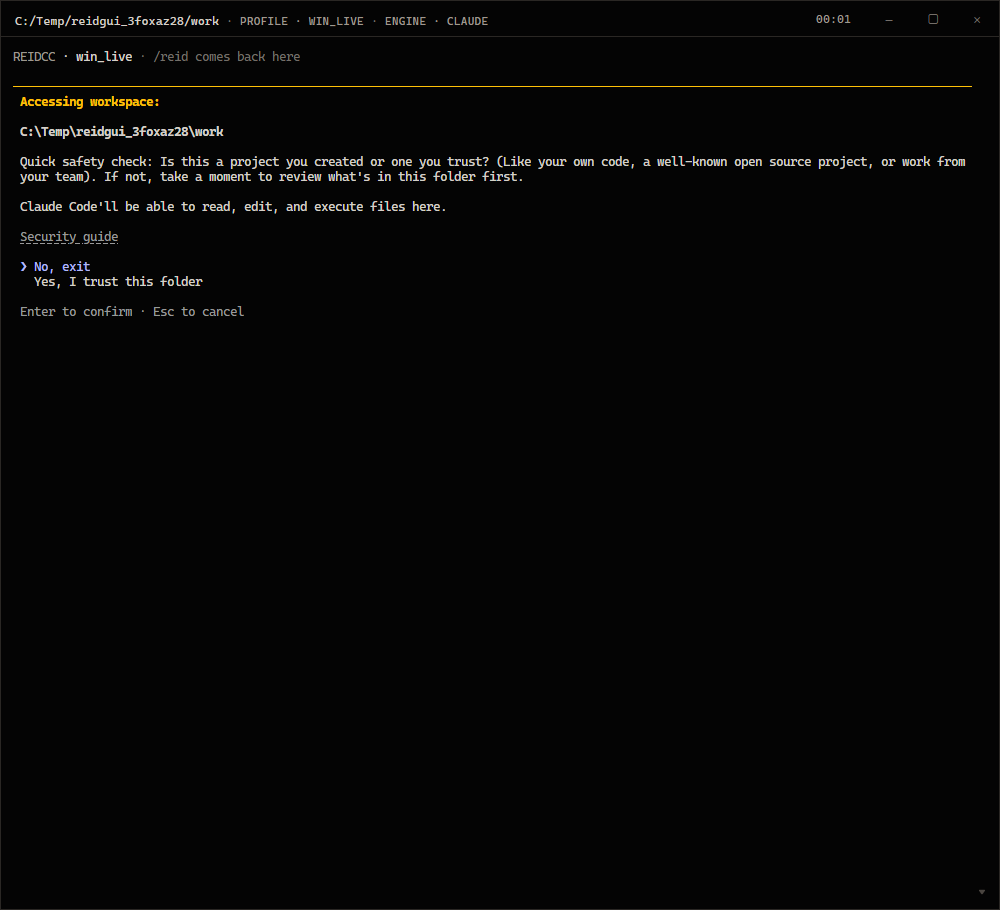

<p align="center">
  
</p>

<h1 align="center">Reidcc</h1>

<p align="center">
  <strong>Open a folder. Start coding.</strong><br />
  Only the essentials, all in sight.
</p>

---

Reidcc is a launcher built on Claude Code and Codex for people who want things simple. Pick a folder and a profile and you are coding in seconds, with your persona, long-term memory and settings already set up. Every session shows where it is, which profile is running, and how much context and limit you have used. Its memory system (`aca`) and request proxy (`proxy`) live here too.

<p align="center">
  
</p>

---

## Layout

```text
E:\Reidcc
├─ app\               THE APP (built): Reidcc.exe = window, reidcc.com / reid.com = terminal
├─ python\            the Python app's source (what app\ is built from)
│  ├─ reid.py         TUI, CLI and engine
│  ├─ reid_gui.py     the app window
│  └─ build\          build.ps1 + spec + make_assets.py (rebuild app\ after editing the source)
├─ rs\                the Rust rewrite: reid.exe (CLI + TUI) and Reidcc.exe (window), 1:1 with the Python app,
│                     plus session window beta; not installed into app\ yet
├─ vision\            how Reidcc looks and talks: palette, design & motion, voice, branding\ art
│  ├─ SPEC-vision-v1.md  vision version 1: sizes, session windows, snap, headless, rigs (session window and snap betas built)
│  └─ Spec\           proxy, gate (built), tui (proposed), codex-opencode (Codex built, OpenCode proposed),
│                     codex-signin-persona (built), codex-proxy (proposed), rust-rewrite (stage 0 built),
│                     rust-tui-gui (1:1 TUI + GUI in Rust, built, awaiting sign-off), app
├─ assets\            banner.png, gate frames (gate_*.png) and TUI half-block gate frames (tui\gate_*.json.gz)
├─ reidcc.ico         app icon: the engraved RC logo (vision\branding\), cut by make_assets.py
├─ reid.json          profiles: engine, model, auth, persona, memory, proxy, tools, mcp, switches
├─ reid_state.json    last session + recent folders (written by reid)
├─ reidcc_memory.md   long-term memory injected into sessions with memory on
├─ personas\          persona prompts used by profiles
├─ json\              Claude Code settings files (API mode); THESE HOLD API KEYS
├─ codex\             Codex sign-in files (*.toml, may hold keys) + prompts\ (persona + memory per launch);
│                     made on first use
├─ mds\               other persona / prompt drafts
├─ aca\               ACA memory server (port 8420), its hooks and MCP server
│  └─ docs\           ACA + Firing System specs
├─ proxy\             mitmproxy add-ons + lean launchers (slim, ultra-slim, mini, stripped)
└─ legacy\            old GUI split attempt, config backups
```

---

## reid: app or tool, auto-detected

<p align="center">
  
</p>

- **Typed in a terminal** (`reid` or `reidcc`) → **TUI** in that terminal (runs `reidcc.com`).
- **Started as an app** (Start Menu `Reidcc`, double-clicking `app\Reidcc.exe`) → **GUI** window.
- **Any arguments** → CLI. `reid --gui` / `reid --tui` force one (from a terminal, `--gui` detaches the window).
- **Rebuilding:** editing `python\reid.py` or `python\reid_gui.py` does nothing until you run `python\build\build.ps1` (about 15 s, atomic swap into `app\`).

### One screen and the gate

The flow is `folder → profile → open gate` in both the GUI and the TUI. The profile list and every field of the selected profile stay visible on one screen, and changes save as you make them.

- **Keys (GUI):** `Enter` on the profile list opens the gate · `Ctrl+Enter` opens the gate from anywhere · `Ctrl+O` picks a folder · `Ctrl+R` resumes · `Esc` clears a message.
- **Keys (TUI):** `↵ open gate · r resume · e edit · n new · x delete · d default · w pick folder · m memory · 1–9 jump · q quit`
- **The gate:** hovering or focusing `open gate` / `resume` shows a faint blueprint ghost of the gate over the launcher. Pressing it starts the session while the gate opens. The Rust beta opens a Reidcc session window by default. The installed Python launcher opens Windows Terminal. Any key or click skips the animation.

<p align="center">
  
</p>

### CLI commands

```text
reid                    Open the TUI in a terminal, or the GUI when launched as an app
reid <profile> [args]   Launch a profile in the current folder
reid --resume           Resume the last Claude session
reid --dry <profile>    Show the exact command and proxy plan without launching
reid -l                 List all profiles and their summaries
reid --tui / --gui      Force the TUI or GUI
reid --edit             Open reid.json
reid --mem              Open reidcc_memory.md
reid -h                 Full CLI help
```

---

## Engines

A profile selects its engine (`claude` or `codex`) on the `name` row. Profiles without an `engine` field default to `claude`. Unsupported fields stay visible and greyed out so nothing is hidden.

### Claude Code

- **Sign-in:** default Claude subscription, or a `json\*.json` settings file (keys stay in the file).
- **Persona and memory:** attach any Markdown persona (`add to Claude Code's prompt` or `replace Claude Code's prompt`) and toggle `reidcc_memory.md`.
- **Statusline:** every session gets `~/folder · PROFILE · MAIN · PERSONA · X   context 42% · limit 61%` (`reid --statusline`; `limit` appears on a subscription after the first reply). Turn it off per profile with `"statusline": false`.
- **Return and resume:** `/reid` inside Claude returns to the TUI with the conversation kept (`r` resumes it with any profile); `/exit` leaves.
- **Lean profiles:** `slim`, `ultra`, `mini`, `mini-slim`, `mini-mcp`, `plain`, `capture`. Proxy profiles start a private `mitmproxy` per session (see `vision\Spec\SPEC-proxy.md`).
  Measured (one-word prompt): `baseline 26,980` input tokens · `slim 22,509` · `ultra 11,659` · `mini 5,217` · `mini-slim 3,920` · `plain 772`.

### Codex

- **Native launch:** resolves the vendored `codex.exe` directly instead of `.cmd` shims, so paths with spaces, `&`, `%` or `^` work cleanly.
- **Sign-in:** uses your terminal `codex login` (status checked in the background: `ChatGPT`, `API key`, or `not signed in`) or a `codex\*.toml` provider file (for LM Studio, OpenRouter, or other APIs).
- **Persona and memory:** uses the same persona files and `reidcc_memory.md` (`add to Codex's prompt` or `replace Codex's prompt`). Generated files live in `codex\prompts\<profile>.md`; nothing is written to `~/.codex`.
- **Session flow:** Codex statusline (`model · folder · context · 5h · weekly`), `REIDCC · codex · <profile>` tab title, and `/quit` returns to the Reidcc TUI. `resume` is Claude-only for now.
- **Proxy *(proposed)*:** per-session `capture`, `slim` and `ultra` add-ons for Codex traffic are specced in `vision\Spec\SPEC-codex-proxy.md`.

### OpenCode *(proposed)*

Researched for `--standalone` per-launch config via `OPENCODE_CONFIG` / `OPENCODE_CONFIG_CONTENT` and `opencode\prompts\`. Not built yet (see `vision\Spec\SPEC-codex-opencode.md`).

---

## Wired up outside this folder

- **User PATH** includes `E:\reidcc\app` (`reid`, `reidcc`; extensionless shims there are for Git Bash).
- **`~\.claude\commands\reid.md`** (the `/reid` slash command).
- **Start Menu** `Reidcc.lnk` → `app\Reidcc.exe`.

---

## aca

Long-term cognitive memory server (separate from `reidcc_memory.md`; Reidcc does not read ACA directly yet).

- **Start:** `aca\start.bat` (prints the server window; closing it stops the server).
- **Health:** `http://127.0.0.1:8420/health` · **Inspector:** `http://127.0.0.1:8420/inspector`

Wired up outside this folder (paths point at `E:/Reidcc/aca/...`):
- `~\.claude\settings.json`: `UserPromptSubmit`, `PostToolUse(Bash)`, `PostToolUseFailure(Bash)` hooks run `aca\integrations\claude_code\aca_hook.py`.
- `~\.claude.json`: user MCP server `aca` runs `aca\integrations\claude_code\aca_mcp.py`.
- `~\.aca\claude_code.key`: the write key the hook and MCP server use.

If this folder moves, update those three places.

---

## proxy

Used by `reid` profiles via the `proxy` field (`slim`, `ultra`, `optimize`, `capture`, or combinations). Each session starts a hidden `mitmdump` on an OS-assigned free port inside a kill-on-close Job Object and logs to `proxy\logs\<profile>.log`.

- The `claude-*.cmd` launchers still work standalone but are superseded by profiles. See `proxy\README.md`.
- **Venv:** `proxy\.venv` (mitmproxy).
- **Tests:** `proxy\.venv\Scripts\python.exe -m pytest proxy\tests -q`
- **Caveat:** `slim` and `ultra` rewrite requests and can break on a Claude Code update. `mini`, `mini-mcp`, `plain`, `claude-mini-native.cmd` and `prompt-remover\` use official flags only.

---

## Rust rewrite & Vision v1

Reidcc is being rebuilt in Rust (`rs\`: Tauri 2 + TypeScript + `portable-pty` + `xterm.js`) using the exact same data files and `mitmproxy` add-ons. Build with `cargo build --release` in `rs\`.

| Stage | Status | Details |
|---|---|---|
| **Stage 0 · core + CLI** | Built | `rs\core`, `rs\cli` (`reid.exe`, 153/154 byte-identical parity with Python) |
| **Stage 1 · 1:1 TUI + GUI** | Built, awaiting sign-off | 48/48 TUI parity, 175/175 GUI `reid.json` parity (`rs\target\release\Reidcc.exe`) |
| **Stage 2 · session windows** | Beta built in Rust | Embedded ConPTY + xterm.js window with Telemetry Bar and drag shimmer |
| **Stage 3 · snap and fuse** | Beta built in Rust | Drag session windows together for a shared frame of up to four live panes. Drag the frame header to move them together or a pane header to pull it out. |
| **Vision v1 · sizes, headless, rigs** | Proposed | `full` / `medium` / `mini pod` dock, headless run strips, orchestrator rigs, TUI redesign |

<p align="center">
  
</p>

---

## Design language

- **Ground:** `#040404` canvas, `#0E0D0C` surface 1, `#171513` surface 2, `#292723` stone dark, `1px` `#2A2724` hairlines.
- **Type:** bone hierarchy (`#D6D0C8` / `#9F978E` / `#746F69`), neo-grotesque sans for UI, monospace with `tabular-nums` on all meters, diffs and timers.
- **Signals:** one emerald (`#00C463`) for ready and active; bronze (`#C99A45`) for loading and 75–89% context; oxide (`#C0584B`) for 90%+ context, limits and errors.
- **Motion:** `cubic-bezier(0.16, 1, 0.3, 1)`, zero bounce, `240ms` per-step ceiling.

---

## License

Reidcc is source-available under the [PolyForm Noncommercial License 1.0.0](LICENSE.md).

- **Free for people:** use it, change it, fork it and share your changes, for personal use, hobby
  projects, study, research, and noncommercial organizations (charities, schools, public bodies).
- **Credit:** every copy and fork keeps the `Required Notice:` line from [LICENSE.md](LICENSE.md).
- **Companies and paid work** (including client work) need a commercial license. Open an issue
  titled `commercial license` to talk terms.
- **Name and art:** the Reidcc name, the RC logo and the art in `vision/branding/` and `assets/` are
  not under the license. Copies of Reidcc may include them unchanged; a fork under another name
  uses its own.
- **Contributing:** by sending a pull request, you agree that your contribution is licensed under
  these terms, and that Reid may also include it in Reidcc's commercial licenses.

---

<p align="center">
  <br />
  <code>Reidcc · built on Claude Code and Codex · only the essentials</code>
</p>
