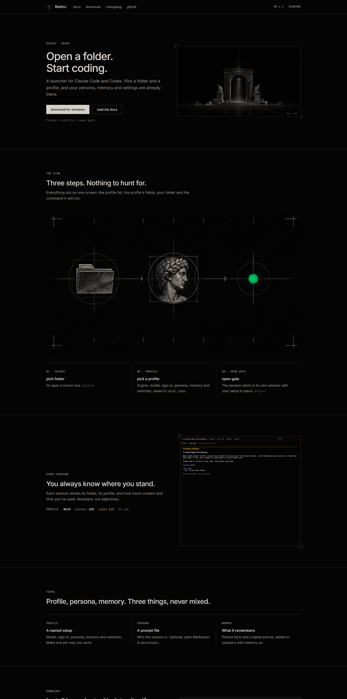
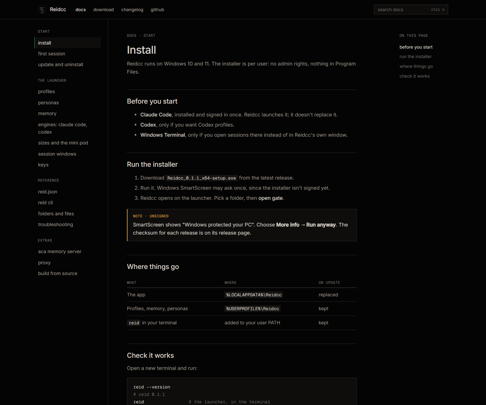
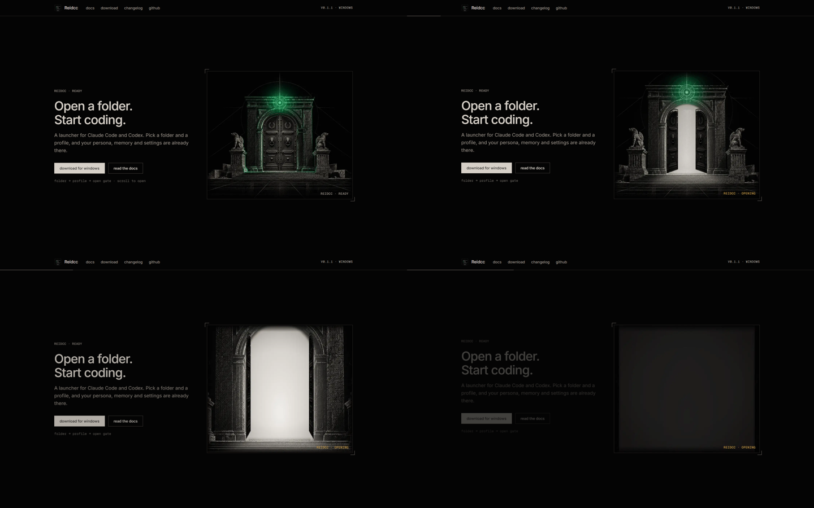

# SPEC: the Reidcc website (GitHub Pages: landing page and docs)

Status: BUILT 2026-11-21 in `site\` (VitePress 1.6.4), deployed by `.github\workflows\pages.yml`. Rev 1 2026-11-21.
Rev 2 2026-11-21: motion (Part 2b). The mock it was ported from stays in `vision\Spec\github-pages\mock\`.

**As built (where it differs from the text below):**
- The top bar is VitePress's own (with local search on every page); the landing page uses `layout: page`
  and adds the progress hairline. The version tag reads `rs\Cargo.toml`, not `tauri.conf.json`.
- Fonts are self-hosted from `@fontsource/inter` and `@fontsource/geist-mono` (latin 400/500), not `publiconts`.
- The download is decided at build time from GitHub's latest release: with an installer, `download for
  windows` + the installer steps; without one, `build from source` + the build steps (truth rule, Part 7.6).
- Only `r00` is in the first load; the other gate frames are fetched after the page's load event.
  Measured: **391 KB first load** in 9 requests (budget 700 KB). 390px: no sideways scroll. Reduced
  motion: 0 hidden, hero 455px. `dist\` scanned clean for personal paths, emails and keys.
- `pages.yml` can't use a `push` trigger: main is pushed by `publish main` with `GITHUB_TOKEN`, which
  starts no workflows, so it runs on that workflow's completion (`workflow_run`), on `release: published`
  and by hand. It builds from main, where `publish main` copies `site\`.
- Favicon is a 32px PNG cut by `make_assets.py --site` (the 150 KB `reidcc.ico` would eat the budget).
- Code blocks are bone, not syntax colours. ACA isn't in the docs while its repo is private.

Asked by Reid 2026-11-21:
> "Spec a github pages website with docs and the feel that the Reidcc project/app feels"

## The idea in one line
One site at `aiden6464-ai.github.io/reidcc`: a landing page that feels like opening the launcher,
and docs that read like the app talks. It's built from Markdown in `site\` and deployed by Actions
on every push to `main`.




---

## Part 0: hosting (decided 2026-11-21)

Reid made the repo **public** under PolyForm Noncommercial 1.0.0 ("Make it public", 2026-11-21),
so Pages is free on it: option A. Options B (GitHub Pro, $4/month) and C (a separate public repo
for the built site) are no longer needed. Deploy straight from this repo (Part 5).

---|---|---|---|
| A. Make `reidcc` public | free | public, so it needs a license first (repo spec, open question 1) | public |
| B. GitHub Pro | $4/month | stays private | public |
| C. Separate public repo `AIden6464-AI/reidcc-site` that holds only the built HTML | free | stays private | public |

**Recommendation: decide this together with the repo spec's "public or private" question.**
If the source goes public, pick A. If it stays private, pick C: the source stays private for free,
and the Pages workflow pushes `site\.vitepress\dist` to the other repo with a deploy key. The
workflow itself is the same either way (Part 5).

I couldn't read the account's plan: the gh token doesn't have the `user` scope.

---

## Part 1: decisions

| Decision | Choice | Why |
|---|---|---|
| Generator | **VitePress** in `site\` (its own `package.json`) | Same toolchain as `rs\ui` (Vite + TS + npm). Docs are Markdown. Sidebar, prev/next, "on this page", local search and Shiki code colouring come built in; hand-rolling those is more code than the theme |
| Theme | VitePress default theme, **re-skinned**: its CSS variables set to the app's tokens, plus one custom `Home.vue` | The docs layout we want is the default layout; only the look changes |
| Colour scheme | **Dark only** (`appearance: 'force-dark'`) | The app has no light mode; the art is near-black |
| Fonts | Inter + Geist Mono, **self-hosted** woff2 (latin subset, 400/500) | The app's own stack. No Google Fonts request: no tracking, no flash of a different font |
| Search | VitePress local search (index built at build time) | No Algolia account, works offline |
| Analytics | **None** | Sovereign identity is pillar 1; a launcher about owning your setup shouldn't track its readers |
| Versioned docs | No, one version | One user base, an auto-updater. YAGNI until two versions are supported at once |
| Changelog | Links to GitHub Releases | The releases already carry the notes the updater shows (repo spec Part 4) |
| URL | `https://aiden6464-ai.github.io/reidcc/` (`base: '/reidcc/'`) | Custom domain is optional, later (open question 3) |
| Source of truth for docs | `site\docs\*.md`. README shrinks to pitch + install + links | One copy. Today the README carries the docs, and two copies drift |

---

## Part 2: the feel

The site is the launcher's own surface. Every rule from `reidcc_design_motion_system.md`,
`reidcc-palette.md` and `reidcc-voice.md` applies unchanged. Here they are, translated to a web page:

| The app | The site |
|---|---|
| `#040404` canvas, warm `surface-1/2`, 1px `#2A2724` hairlines | Same tokens (`site\.vitepress\theme\tokens.css` is a copy of `rs\ui\src\style.css`'s `:root`). Sections are separated by hairlines. No cards, no shadows, no glass, no gradients |
| One emerald point visible at a time | The art's own emerald point is the only one in view. On the landing page there is no green UI. In the docs it's the active page's sidebar edge, and nothing else |
| Engraved texture only inside artwork | Art is shown framed and is never a page background. Text sits on flat canvas |
| Corner registration marks | The art frames get two corner ticks (`text-3`), as in the mock |
| `REIDCC · READY` mono tags | Every section starts with an 11px mono uppercase tag (`THE FLOW`, `DOCS · START`) |
| Lowercase buttons, `folder → profile → open gate` | Buttons: `download for windows`, `read the docs`. The muted mono hint under the hero is the app's own hint |
| Hovering `open gate` shows the gate's ghost | The gate is already on screen, so hovering `download for windows` parts its doors instead (Part 2b) |
| Motion ≤ 240ms, no bounce | Every timed step ≤ 240ms on one curve. Longer moves are sequences of steps, or follow the scroll position (Part 2b) |
| `tabular-nums` on numbers | On all mono text: telemetry examples, versions, tables of sizes |
| Voice: short, declarative, no hype, no emoji or `!` | The same, on every page. Banned words list applies (`magic`, `awesome`, `simply`, `just`...) |
| Words: folder, profile, persona, memory, session, open gate | The same. Never "workspace", "agent", "chat", "launch" in prose |

### 2b. Motion: scrolling, hovering, clicking (rev 2, built in the mock)

> "Make high level animationsions for scrolling and clicking or hovering" (Reid, 2026-11-21)

Rev 1 said "no scroll-triggered animation". That's withdrawn. Every animation below still keeps the
design doc's rules:
- **No timed step longer than 240ms**, on the design doc's one curve `cubic-bezier(0.16, 1, 0.3, 1)`. A longer move is either
  a sequence of such steps (like the app's gate) or follows the scroll position. A scroll-driven
  move has no duration, so the reader never waits for it.
- **One emerald point in view.**
- **Nothing bounces, floats or loops.**
- **Every animation means something.** It is one of the app's own: the gate, a construction line, a
  measurement.



Files: `mock\motion.css`, `mock\motion.js` (~220 lines, no library: rAF and IntersectionObserver).
Tested in Edge with Playwright: every number below was read off the running page, and there were no console errors.

**Scrolling**

| Where | What happens | Why it's on brand |
|---|---|---|
| **Hero: the gate** | On load, the gate rises out of its lines and the keystone ignites. These are the app's own frames (`assets\gate_rise` + `gate_ignite`, 14 frames in 360ms, the `gate.json` timing). Then the hero is a sticky stage, and scrolling through it plays the 30 `gate_open` frames: the doors swing, light fills the passage, and the view goes through into the dark, while the text steps back (opacity 1 → 0.2). The tag reads `REIDCC · READY` → `REIDCC · OPENING` (bronze) → gone, as in the app | Scrolling down the page **is** opening the gate |
| **Sections** | Each section draws in once as it enters the view. Its hairlines draw from the left (240ms), its column dividers draw downward, and its text lands 10px up and fades in, 60ms apart. A frame's registration ticks snap on last | A construction drawing being drawn |
| **The flow art** | The Classical Blueprint Flow art starts as a dim grey copy. A scan line moves along its flow line with the scroll and leaves the art in full colour behind it: folder, then persona, then the **●**. The ● has no colour until the line reaches it, then flares once (emerald-hot, 240ms). The step columns below light up as the line passes each node | `folder → profile → open gate`, played by the reader's own scroll. The only emerald comes last |
| **Telemetry** | `context 42%` and `limit 81%` count up from 0 in one 240ms step. The limit turns bronze when it crosses 75%, the app's real threshold | Numbers over adjectives, live |
| **Top bar** | A 1px linework line along the bar's lower edge shows how far down the page you are | Instrument, not decoration |

**Hovering**

| Where | What happens |
|---|---|
| `download for windows` | The gate's doors part a hand's width (open frames 0–7 in 150ms) and close again on leave. It previews what the click does |
| Every button | Two registration ticks slide onto opposite corners (140ms) |
| Nav and footer links | A hairline underline draws from the left (140ms) |
| Step columns | A linework line draws across the column's top edge (200ms), and its title brightens |
| Art and screenshots | A measuring crosshair follows the cursor with a mono readout in the art's own pixels (`x 0836 · y 0442`). Off on touch screens |
| Docs sidebar | The emerald edge slides to the hovered link (200ms) and back to the current page on leave |
| Docs code blocks | A `COPY` button fades in |

**Clicking**

| Where | What happens |
|---|---|
| `download for windows` (hero) | The gate opens the rest of the way (480ms, the app's open timing), the view goes through into the dark, and the page lands on the download section, which draws in. Any key or click skips, like the app. On the real site the click also starts the download |
| Every button | Pressed 1px down. A 160ms ring spreads and fades: emerald-hot on the primary button (go), linework on the others |
| Docs `COPY` | Copies the command lines only (not the `#` comments) and reads `COPIED` for 1.2s |
| Docs "on this page" | Follows the reading position |

**Reduced motion** (`prefers-reduced-motion`): no reveals, everything visible at once. The gate
shows still and ready, the hero isn't sticky, the flow art is fully lit, and there are no presses or
peeks. Checked: 0 hidden elements, hero 455px instead of 210vh.
**Phones:** the hero isn't sticky (the gate opens as the hero scrolls away), there's no crosshair, and
no sideways scroll at 390px (checked).
**Weight:** the 44 gate frames are 800px WebP, 1.7 MB in total. On the real site, only the first
frame is in the first load; the rest load after it, so the 700 KB budget holds.

**Truth rule (from the voice guide):** the site only says what the shipped app does. A
feature marked proposed in `vision\` isn't on the site, or sits under a `PROPOSED` tag in its
docs page. That covers OpenCode, headless, orchestrator, ACA in the UI, and the installer and
updater until they ship. An ACA count or "remembered" claim on the site needs the same proof the
app needs.

---

## Part 3: the pages

### 3a. Landing (`/`, custom `Home.vue`)
Order is the app's order. Every band is one claim plus its proof:

1. **Top bar:** RC logo, `Reidcc`, `docs · download · changelog · github`; right: `V0.1.1 · WINDOWS`
   (read from `rs\app\tauri.conf.json` at build time, so it can't go stale).
2. **Hero:** tag `REIDCC · READY`, *Open a folder. Start coding.*, the one-sentence pitch from the voice
   guide, `download for windows` + `read the docs`, hint `folder → profile → open gate`. Right: the gate
   (Emerald Portal), framed. Ghost on hover.
3. **The flow:** Classical Blueprint Flow art, then three hairline columns `01 · FOLDER`, `02 · PROFILE`,
   `03 · OPEN GATE`, each with its key.
4. **Every session:** a session window screenshot, plus the telemetry line in mono
   (`PROFILE · MAIN · context 42% · limit 81%`, coloured by the app's real thresholds).
5. **Yours:** profile / persona / memory, three columns, "three things, never mixed".
6. **Download:** what the installer does (per-user, no admin, data folder kept), plus a 3-line mono
   "what happens" block.
7. **Footer:** Compass and Marble Hand emblem (the art the palette reserves for README and marketing),
   *Only the essentials, all in sight.*, links, license.

Not on the landing page: feature grids, testimonials, a comparison table, "built with AI" badges, or a
newsletter.

### 3b. Docs (`/docs/...`, default layout re-skinned)
Three columns: sidebar · page (72ch max) · "on this page". The sidebar is the order a new user needs
things in:

| Group | Pages | Source today |
|---|---|---|
| **start** | install · first session · update and uninstall | repo spec Parts 3, 4, 7 (once built); until then: build from source |
| **the launcher** | profiles · personas · memory · engines (Claude Code, Codex) · sizes and the mini pod · session windows · keys | README "One screen and the gate", "Engines", design doc "Vision version 1" (built parts only) |
| **reference** | `reid.json` (every field, one table) · `reid` CLI · folders and files · troubleshooting | README "CLI commands", "Layout"; `core` config structs |
| **extras** | ACA memory server · proxy · build from source | README "aca", "proxy", "Rust rewrite"; repo spec Part 6 |

Page anatomy (see `docs.png`): crumb tag, `h1`, one-line lead, then `h2` sections each opened by a
hairline. Code blocks on `surface-1` with a hairline border. Callouts are a container with a 2px
left edge: `NOTE` bronze, `WARNING` oxide. There's never an emerald callout, because emerald means ready,
not tip. Prev/next pager at the bottom.

Screenshots in docs are real captures from the app (`rs\tests\session_shots`, the GUI flow
screenshots), retaken by script, never mockups. Example content uses a neutral profile (`main`),
folder (`~/projects/kiln`) and memory. **Never Reid's real memory, personas or paths.**

### 3c. 404
Canvas, the gate's ghost lines at full strength, tag `REIDCC · NO GATE HERE`, one link `back to docs`.

---

## Part 4: the repo side

```text
site\
├─ package.json            vitepress (pinned), nothing else
├─ .vitepress\
│  ├─ config.ts            title, base '/reidcc/', force-dark, sidebar, local search, head (og image)
│  └─ theme\
│     ├─ index.ts          extends DefaultTheme, registers Home.vue
│     ├─ tokens.css        the app's :root tokens (copied; a CI check diffs it against rs\ui\src\style.css)
│     ├─ theme.css         maps --vp-c-* to the tokens; hairlines; type scale; motion
│     └─ Home.vue          the landing page (ported from mock\index.html)
├─ index.md                layout: home
├─ docs\*.md               the pages in Part 3b
└─ public\
   ├─ fonts\               Inter + Geist Mono woff2 (latin, 400/500), with their OFL license files
   ├─ art\                 WebP cuts of the branding art (made by make_assets.py --site)
   └─ shots\               app screenshots
```

**Art weight.** `vision\branding\` is 18 MB of 1.2–2.5 MB PNGs. The site never links them.
`python\build\make_assets.py --site` writes WebP cuts at the sizes used (hero 1200w + 600w via
`srcset`, flow 1120w, emblem 144px, logo 52px, og image 1200×630 from the banner). **Budget: the landing
page's first load ≤ 700 KB**, fonts included. The mock links the full PNGs and is about 9 MB, which is
fine for a mock and not fine for the site.

**Images not to use:** the unnamed branding PNG `36f0c166…`. (Its duplicate twin `4899f286…` was deleted.)

---

## Part 5: build and deploy

`.github\workflows\pages.yml`, separate from `ci.yml` so a docs edit doesn't run the Rust tests:

```yaml
on:
  push: { branches: [main], paths: ['site/**', 'rs/app/tauri.conf.json'] }
  workflow_dispatch:
permissions: { contents: read, pages: write, id-token: write }
concurrency: { group: pages, cancel-in-progress: true }
jobs:
  build:
    runs-on: ubuntu-latest          # Linux minutes count 1x; Windows counts 2x
    steps:
      - uses: actions/checkout@v5
      - uses: actions/setup-node@v5
        with: { node-version: 22, cache: npm, cache-dependency-path: site/package-lock.json }
      - run: npm ci && npm run build
        working-directory: site
      - run: diff <(sed -n '/^:root/,/^}/p' rs/ui/src/style.css) site/.vitepress/theme/tokens.css   # tokens drift check
      - uses: actions/upload-pages-artifact@v4
        with: { path: site/.vitepress/dist }
  deploy:
    needs: build
    runs-on: ubuntu-latest
    environment: { name: github-pages, url: '${{ steps.d.outputs.page_url }}' }
    steps:
      - id: d
        uses: actions/deploy-pages@v4
```

Repo settings: Pages → Source: **GitHub Actions**. Add the site URL to the repo's About box.
About 40 s per deploy.

**Local preview:** `cd site && npm i && npx vitepress dev` serves it at `localhost:5173/reidcc/`.

---

## Part 6: checks before the first deploy

- [x] Part 0 decided; license chosen (PolyForm Noncommercial 1.0.0).
- [ ] Every docs claim matches the shipped app (go page by page against the truth rule).
- [ ] No personal data: grep `dist\` for local user paths, `E:\\`, emails, API-key patterns, the same scan the
      repo got before its first push.
- [ ] Landing ≤ 700 KB first load; Lighthouse accessibility ≥ 95.
- [ ] Contrast on `#040404`: `text` 13.4:1, `text-2` 7.1:1, `text-3` **4.1:1**. Small text needs
      4.5:1, so `text-3` fails it. Any text a reader needs (sidebar group tags, "on this page", crumbs)
      uses `text-2`. `text-3` is only for separators (`·`, `→`) and decorative ticks. The mock still
      uses `text-3` for some tags; fix that in the port.
- [ ] 390px wide: no horizontal scroll, 16px gutters (the mock passes at 500px; check 390 in a real phone).
- [ ] Keyboard: visible focus ring (`hairline-strong` + emerald-hot 1px on press), skip link, search on `ctrl k`.
- [ ] `prefers-reduced-motion`: reveals, scrub, peek and presses are off (Part 2b).

---

## Part 7: build order

1. ~~Part 0 decision (and license).~~ Done: public, PolyForm Noncommercial.
2. `site\` scaffold, tokens, theme, port `Home.vue` from the mock.
3. Docs pages, moved out of the README (README keeps the pitch, install and a link).
4. `make_assets.py --site`, fonts, real screenshots.
5. `pages.yml`, Pages source set, first deploy, Part 6 checks.
6. When the installer ships (repo spec Part 8): `download for windows` points at
   `releases/latest`. Until then it says `build from source` and opens that page.

## Open questions
1. ~~Public or private~~ Decided: public (Part 0).
2. **A design page?** The palette, voice and motion docs are good enough to publish as
   `/docs/design`. Should they be public?
3. **Custom domain** (e.g. `reidcc.dev`)? It costs money each year and adds a DNS setup. Leave it for later.
4. **How long the gate scroll is.** The hero is 210vh, so it takes about one screen of scrolling to go
   through the gate. Shorter feels snappier, and longer feels grander. It's tuned by one number (`.hero { height }`).
   Try it in the mock and pick.
