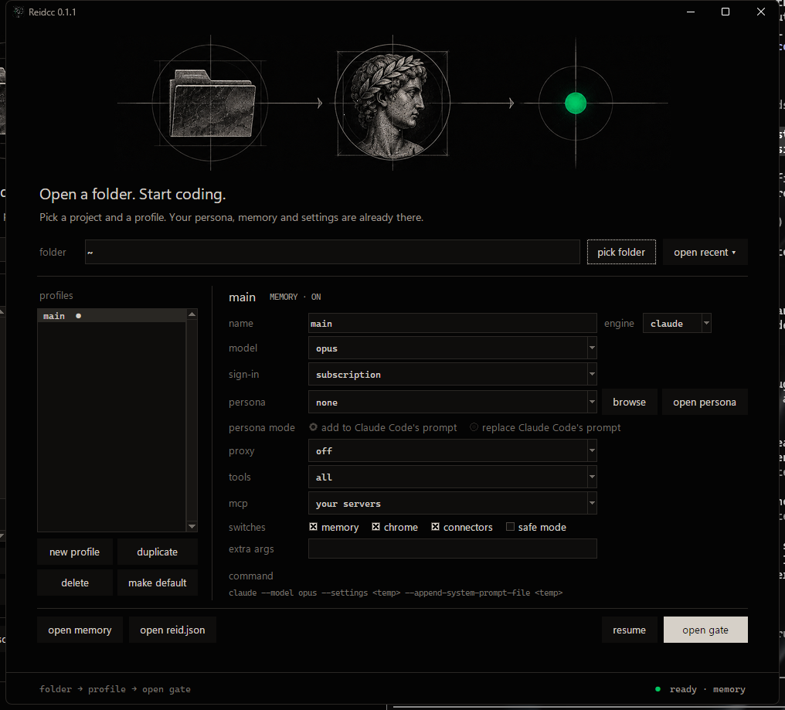
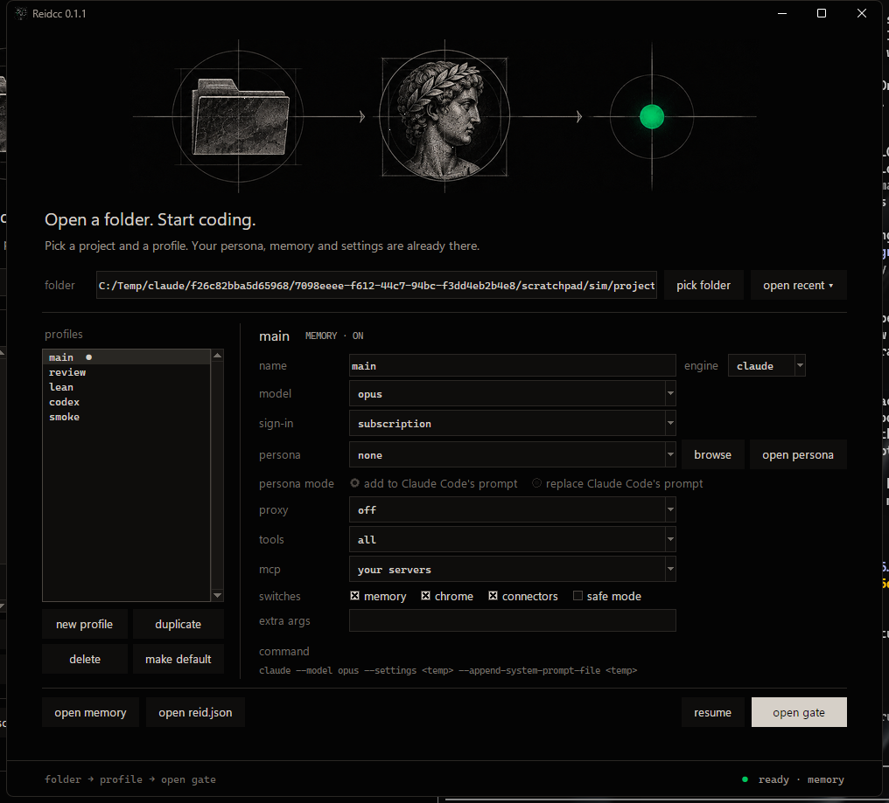

# SPEC: Reidcc as a GitHub repo (installer, updater, memory, the user's folders, a simulated first day)

Status: PROPOSED. Rev 1 2026-11-21 (repo, zip install, simulation). Rev 2 2026-11-21: a real
installer and updater, the launcher at the top, the program and your data in separate folders, and
how memory (reid.json, reidcc_memory.md, ACA) works once installed. Nothing here is built except
what Part 7 marks as **ran**.

Asked by Reid 2026-11-21:
> "Spec out this as a GitHub repo and how it would be installed and looks in the folder of the user
> and simlate so one useing it end to for dev work and simulate installation of setup"

> "how would the memery system work like this the ACA and reid.json also we need a installer and
> updater [...] because weres the launcher?"

## The idea in one line
`Reidcc_<ver>_x64-setup.exe` installs the launcher per-user without admin rights. It updates itself
from GitHub Releases with one click. Your profiles, memory and keys live in `%USERPROFILE%\Reidcc`,
which no install, update or uninstall ever touches.

---

## Part 1: decisions

| Decision | Choice | Why |
|---|---|---|
| What ships | The **Rust** app: `Reidcc.exe` (launcher) + `reid.exe` (CLI/TUI) | 1:1 parity done (CLI 153/154, TUI 48/48, GUI 175/175) |
| Installer | **Tauri 2's NSIS bundler**, `installMode: currentUser` | Already in the stack (the app is Tauri). No admin, no UAC. Handles WebView2 on Windows 10 |
| Updater | **`tauri-plugin-updater`** + GitHub Releases `latest.json`, signed | The platform's own updater; signature checked before anything runs |
| Program vs data | Two folders (Part 2) | The installer and updater replace the program folder; your data must not be in it |
| Data folder | `%USERPROFILE%\Reidcc` | Visible and easy to find. Not `Documents`: OneDrive often syncs it, which would upload `json\` keys and break ACA's SQLite |
| Portable / dev | Still works: a `reid.json` above the exe wins | `E:\Reidcc` stays exactly as it is for Reid |
| `reidcc_memory.md` | Ships on, as the memory | Small, readable, works for Claude and Codex |
| ACA | Optional installer component, **after** its fixes (Part 5f) | Python server; recall quality isn't ready for other users yet |
| proxy | Not in the installer (v1) | mitmproxy venv is 115 MB; rewrites requests and can break on Claude Code updates |
| Python app | In the repo as the parity oracle, never in releases | Delete after Rust sign-off |
| License | **PolyForm Noncommercial 1.0.0**; name and art reserved (decided 2026-11-21) | Reid: free to edit, change and fork with credit; companies "need to talk with me or even payment" |

---

## Part 2: where things are, and where's the launcher

**The launcher is `Reidcc.exe`.** In rev 1 it sat in `bin\`, out of sight. Now it's at the top of
the program folder, and you reach it the usual ways:
- **Start Menu → Reidcc** (made by the installer)
- **Desktop → Reidcc** (installer checkbox, on by default)
- **`reid`** in any terminal opens the TUI, the same launcher in text
- Taskbar pin: right-click the running window → Pin to taskbar (Windows' own)

### 2a. The program folder: owned by the installer, replaced on every update
```text
%LOCALAPPDATA%\Reidcc\                 (Tauri's per-user default)
├─ Reidcc.exe            THE LAUNCHER (window), 10.4 MB, UI embedded
├─ reid.exe              CLI + TUI, 1.4 MB (on PATH)
├─ assets\               gate frames, banner, TUI gate frames
├─ reidcc.ico
├─ aca\                  only if the ACA component was picked (Part 5)
│  └─ aca-server\aca-server.exe + _internal\     (frozen Python, ~35 MB)
└─ uninstall.exe
```
Never edit anything here: the next update overwrites it.

### 2b. Your folder: yours alone
```text
%USERPROFILE%\Reidcc\                  e.g. C:\Users\dev\Reidcc
├─ reid.json             your profiles                         (written on first run)
├─ reid_state.json       last session + recent folders         (written by reid)
├─ reidcc_memory.md      long-term memory                      (written on first run)
├─ personas\             your persona .md files
├─ json\                 Claude settings files for API sign-in   ← KEYS
├─ codex\                Codex provider .toml (may hold KEYS) + prompts\ (regenerated per launch)
└─ aca\                  only with ACA: data\ (SQLite graph, raw log), key
```
The launcher's `open reid.json` and `open memory` buttons open these. The footer shows the folder.

### 2c. How each exe finds your folder (one branch added to `core::home_dir`)
1. `REIDCC_HOME` if set (tests use it).
2. A `reid.json` in the exe's folder or above it (portable and dev: `E:\Reidcc`, `rs\target\release`).
3. **New:** `%USERPROFILE%\Reidcc`, created on first run.

Assets keep today's rule (walk up from the exe), so `assets\` sits next to `Reidcc.exe` in 2a.

### 2d. Outside both folders
PATH entry · Start Menu and desktop shortcuts · `~\.claude\commands\reid.md` (`/reid`) ·
`%LOCALAPPDATA%\com.reidcc.app\` (WebView2 cache) · `reid_*` temp files in `%TEMP%`, one settings
file and one prompt file per launch. Nothing is written to `~\.claude\settings.json`, `~\.codex` or
`~\.claude.json`; ACA's hooks are per session (Part 5d).

---

## Part 3: the installer

### 3a. What the user does
1. Download `Reidcc_0.1.1_x64-setup.exe` (~8 MB, ~43 MB with ACA) from the repo's Releases page.
   Or, from a terminal: `winget install Reidcc` once it's listed (open question 4).
2. Run it. No admin prompt. Unsigned builds get SmartScreen's "Windows protected your PC" →
   *More info* → *Run anyway* (open question 3).
3. Choose components: **Reidcc** (required) · **Desktop shortcut** (on) · **ACA memory (beta)** (off).
4. Finish → **Launch Reidcc** (checked).

### 3b. What it does
| Step | Done by |
|---|---|
| Copy 2a into `%LOCALAPPDATA%\Reidcc` | NSIS |
| Install WebView2 if missing (Windows 10) | NSIS (`webviewInstallMode: downloadBootstrapper`) |
| Start Menu + desktop shortcuts, Add/Remove Programs entry | NSIS |
| PATH += install folder, and `/reid` into `~\.claude\commands\` (if `~\.claude` exists) | post-install hook runs `reid.exe --install` |
| Report which engines it found (`claude`, `codex`) and whether they're signed in | `reid.exe --install` output, shown on the finish page |

It never creates or changes your folder. The first launch does that (Part 7, step 2).

### 3c. The build side (`rs\app\tauri.conf.json`)
```jsonc
"bundle": {
  "active": true,
  "targets": ["nsis"],
  "icon": ["../../reidcc.ico"],
  "externalBin": ["binaries/reid"],            // reid-x86_64-pc-windows-msvc.exe → reid.exe
  "resources": { "../../assets": "assets", "../../reidcc.ico": "reidcc.ico" },
  "createUpdaterArtifacts": true,
  "windows": { "nsis": {
    "installMode": "currentUser",
    "installerHooks": "installer/hooks.nsh",   // POSTINSTALL: reid --install · PREUNINSTALL: reid --uninstall
    "startMenuFolder": "Reidcc"
  } }
}
```

### 3d. Uninstall (Settings → Apps → Reidcc → Uninstall)
Removes the program folder, shortcuts, PATH entry and `/reid` (via `reid --uninstall`). The
checkbox *Delete application data* also removes the WebView2 cache. **It never deletes
`%USERPROFILE%\Reidcc`**; the last page says where it is, so you can delete it yourself or keep it
for a reinstall.

---

## Part 4: the updater

### 4a. What the user sees
- Reidcc checks GitHub in the background when it starts and every 6 hours after. Offline is silent.
- When there's a newer version, the footer's right side shows `update 0.1.2 · install` in place of
  `ready · memory`, until it's clicked.
- Clicking it:
  - **With sessions running:** `finish your 2 sessions first`. An update restarts Reidcc, and the
    session windows run inside it, so they'd end. Nothing is lost by waiting.
  - **With none:** the footer shows `downloading 0.1.2 · 63%`. Then the signature is checked, the
    installer runs in passive mode (a small progress bar, no questions), and Reidcc restarts on the
    same folder and profile, since `reid_state.json` survives.
- **TUI / terminal users:** the TUI footer shows `update 0.1.2: reid --update`, read from the last
  check the launcher saved in `reid_state.json`. `reid --update` runs `Reidcc.exe --update`, the
  same flow.
- It never installs without a click.

### 4b. Rules
- **Only installed copies update.** If the exe isn't in the folder the installer registered (HKCU
  uninstall key), there's no check: dev builds in `rs\target` and portable `E:\Reidcc` never try to
  "update" into `%LOCALAPPDATA%`. This needs no config switch.
- **Your data is never migrated in place without a copy.** If a version ever changes `reid.json`'s
  shape, it writes `reid.json.bak-<old version>` first. Newer fields are ignored by older versions,
  so rolling back is just running the older `setup.exe`.
- **Signed.** `tauri-plugin-updater` refuses a download whose minisign signature doesn't match the
  public key built into the app. The private key lives only in the GitHub secret
  `TAURI_SIGNING_PRIVATE_KEY`.

### 4c. The build side
```jsonc
// tauri.conf.json
"plugins": { "updater": {
  "pubkey": "<minisign public key>",
  "endpoints": ["https://github.com/<owner>/reidcc/releases/latest/download/latest.json"],
  "windows": { "installMode": "passive" }
} }
```
`.github/workflows/release.yml` runs on tag `v*`: `npm ci && npm run build` (ui) → `cargo test` →
`tauri-apps/tauri-action` builds `setup.exe`, signs it, and uploads `setup.exe`,
`setup.exe.sig` and `latest.json` to the GitHub Release. Shipping a version means: bump
`[workspace.package] version`, tag, push.

---

## Part 5: memory, once installed

### 5a. Four files and one server, one job each
| Piece | Job | Written by | Read |
|---|---|---|---|
| `reid.json` | **Who**: profiles and their switches. Config, not memory | you, the launcher | every launch |
| `reid_state.json` | **Where you left off**: last session id, profile, folder, recent folders | reid | `resume`, `open recent`, update restart |
| `reidcc_memory.md` | **What you always know**: pinned facts + a dated journal | you, and the persona during sessions | whole (trimmed) at launch, profiles with `"memory": true` |
| `codex\prompts\<profile>.md` | The same persona + memory, in the form Codex reads | reid, regenerated each launch | Codex at start |
| **ACA** (`aca\data\`) | **What's relevant right now**: a graph of past turns and outcomes, recalled per prompt | the hook, automatically | each prompt, profiles with `"aca": true` |

`reid.json` controls the rest, per profile:
```json
"main":   { "model": "opus", "memory": true, "aca": true },
"review": { "model": "sonnet", "persona": "personas/reviewer.md", "memory": true },
"critic": { "persona": "personas/critic.md", "memory": true, "memory_file": "memory/critic.md" },
"lean":   { "tools": ["Read","Edit","Bash"], "memory": false }
```
- `memory` on/off · `memory_file` gives a profile its own memory (COS roles: Planner, Critic and so
  on). The default is the top-level `memory_file`, shared · `memory_limit` sets the character cap
  (default 6000) · `aca` (new) turns on per-prompt recall.

### 5b. At launch (exists today, unchanged)
```text
reid.json ─ profile ─┬─ persona .md ─────────────┐
                     └─ reidcc_memory.md          │
                        trimmed to 6000 chars:    ├─► one prompt file in %TEMP%
                        keeps all pinned facts,   │   ─► claude --append-system-prompt-file (or --system-prompt-file)
                        drops the oldest journal  │   ─► codex: codex\prompts\<profile>.md
                        lines first ──────────────┘
```
The memory block tells the persona where the file is, and to append facts under
`## Pinned facts` and dated lines under `## Journal` with its file tools. The next launch reads the
updated file, so memory carries across sessions, profiles and both engines.

> **Superseded 2026-11-21:** 5c-5e (per-session hook wiring, the PyInstaller server, the installer
> component) are replaced by the ACA plugin; see `SPEC-plugins.md`. 5f and 5g still apply.

### 5c. Per prompt, with `"aca": true` (Claude only: Codex has no hooks)
```text
you type a prompt
  └─ Claude Code runs the UserPromptSubmit hook: reid.exe --aca-hook
       ├─ POST /v1/ingest  (your words; pasted logs are used for recall only)
       ├─ gets back the top memories, within a 600-token budget, scoped to this project
       └─ prints them ─► Claude sees them as extra context on this turn
a Bash test/build/lint finishes
  └─ PostToolUse hook: reid.exe --aca-hook ─► POST /v1/outcome  (surprising failures become memories)
```
The hook fails open: if the server is down or slow (4 s), Claude carries on with no context added.

### 5d. How ACA gets wired: per session, not globally
Today ACA's hooks live in the global `~\.claude\settings.json`, so they run in **every** Claude
session on the machine, including ones that never went through Reidcc. Installed, they are added
to the per-session `--settings` file Reidcc already writes for its statusline, and only for
profiles with `"aca": true`. Nothing global is written, and uninstalling leaves nothing behind.

The hook moves from `python aca_hook.py` to **`reid.exe --aca-hook`**, a Rust port of
`aca_hook.py` + `aca_client.py` (~200 lines). It's used on every prompt, so it shouldn't need
Python installed or pay Python's ~150 ms start-up each time.

### 5e. The ACA server's lifecycle
- Launching an `"aca": true` profile checks `GET 127.0.0.1:8420/health`. If nothing answers, reid
  starts `aca\aca-server\aca-server.exe` hidden and detached, with
  `ACA_DATA_DIR=%USERPROFILE%\Reidcc\aca\data`, and waits up to 3 s. If it still doesn't answer,
  the session starts anyway and the footer shows `aca offline`.
- If port 8420 answers but isn't ACA, reid says so and doesn't start a second server.
- The server outlives sessions, so all Reidcc sessions and terminals share one. `reid --aca stop`
  stops it. The footer's `aca` link opens the Inspector (`/inspector`).
- **Key:** the first start creates a `claude_code`-role key in `%USERPROFILE%\Reidcc\aca\key`. The
  hook gets that path through `ACA_API_KEY_FILE` in the session's env. No `~\.aca`.
- Data never leaves the machine: the server binds `127.0.0.1` only.

### 5f. ACA fixes before it ships to anyone else (seen in this very session)
Every prompt in this conversation carried about 3 KB of ACA context labelled **"Pinned rules"**.
It was old `cargo` errors (`E0618 … app\src\main.rs:206`, `CreateJobObjectW … win.rs:129`) and
`test result: ok` lines, from code that has since been fixed. Paths were from `E:\reidcc` while
working in `E:\buckups\cc launcher`. Three bugs:
1. **Outcomes get pinned.** Bash results reported to `/v1/outcome` end up in `pinned_core`. Only a
   user's stated rule ("never deploy on Fridays") should be pinned. An outcome may become a memory,
   never a rule.
2. **No project scope on pinned items.** `scope_for(cwd)` exists, but pinned items are recalled in
   every folder.
3. **Pinned items never age out.** A build error from November is "pinned" forever. Outcome-derived
   memories need decay; rules need an expiry or a confirm.

Until these are fixed, ACA stays an unticked beta component, and `reidcc_memory.md` is the memory.

### 5g. Moving Reid's own setup over (when he chooses to)
1. Set `"aca": true` on the profiles that should use it.
2. Remove the five ACA hooks from `~\.claude\settings.json`. Otherwise a Reidcc session runs both
   the global and the per-session hook, and every prompt is ingested twice.
3. Keep `E:\Reidcc\aca\data` and point `ACA_DATA_DIR` at it. Nothing is migrated or lost.

---

## Part 6: the repo

```text
github.com/<owner>/reidcc
├─ .github/workflows/ci.yml        push/PR: ui build, cargo test, cargo build --release
├─ .github/workflows/release.yml   tag v*: tauri-action → setup.exe + .sig + latest.json (Part 4c)
├─ .gitignore                      Part 6b; exists BEFORE the first `git add`
├─ LICENSE
├─ README.md                       image links fixed (Part 8, item 5)
├─ rs/                             core, cli (reid.exe), app (Reidcc.exe; tauri.conf.json, installer/hooks.nsh), ui, tests
├─ python/                         reid.py, reid_gui.py: parity oracle only
├─ assets/  reidcc.ico             26 MB; largest file < 3 MB, no LFS needed
├─ personas/plain.md               the one example persona
├─ vision/                         palette, motion, voice, specs, branding/ (18 MB)
├─ docs/                           launcher.png, session-window.png (README links them; missing today)
├─ aca/                            server source + build/aca.spec (PyInstaller → aca-server.exe)
└─ proxy/                          add-ons, tests (not in the installer)
```

### 6b. `.gitignore`
```gitignore
# secrets: every file in json\ today holds an API key (29 of 29); codex\*.toml may too
json/
codex/
# personal data, written at runtime
reid.json
reid_state.json
reidcc_memory.md
reid.json.bak-*
memory/
personas/*
!personas/plain.md
mds/
aca/data/
proxy/logs/
proxy/audit/
# build output
app/
rs/target/
rs/ui/node_modules/
rs/ui/dist/
rs/app/binaries/
python/build/dist/
python/build/work/
aca/build/dist/
**/__pycache__/
**/.venv/
.webview/
# scratch
legacy/
.test/
New Text Document.txt
```

---

## Part 7: a simulated first day

What **ran** used the real 0.1.1 binaries in an empty folder, with `REIDCC_HOME` pointed there
(`E:\Reidcc` was never read or written). That stands in for `%USERPROFILE%\Reidcc` (2c, rule 1).
Steps marked **narrated** were not run, because there's no installer build yet or they'd spend a
real session.

**1. Install.** *(narrated)* `Reidcc_0.1.1_x64-setup.exe` → components (Reidcc, desktop shortcut) →
Install → the finish page shows:
```text
Reidcc 0.1.1 installed in C:\Users\dev\AppData\Local\Reidcc
  + PATH        (new terminals)
  + /reid       ~\.claude\commands\reid.md
  claude  found, signed in (subscription)
  codex   found, signed in (ChatGPT)
[x] Launch Reidcc
```

**2. First launch.** *(ran)* Reidcc creates your folder with a working profile and an empty memory:
```text
$ reid --version
Reidcc 0.1.1
$ reid -l
* main           opus · subscription · memory
```
```text
C:\Users\dev\Reidcc\
├─ reid.json          { "default": "main", "memory_file": "reidcc_memory.md",
│                       "profiles": { "main": { "model": "opus", "memory": true } } }
└─ reidcc_memory.md   # Long-term memory / ## Pinned facts / ## Journal / - 2026-11-21 - memory init
```


**3. Setting up for dev work.** *(ran)* A reviewer persona and four profiles, added in the window
(`new profile`, `duplicate`) or in `reid.json`:
```text
$ reid -l
* main           opus · subscription · memory
  review         sonnet · subscription · persona reviewer · memory
  lean           opus · subscription · 5 tools · no mcp · chrome off
  codex          codex · engine default · codex login · checking… · memory
  smoke          provider default · subscription
```


**4. Checking what each profile runs.** *(ran)*
```text
$ cd my-project && reid --dry review
claude.exe --model sonnet --settings %TEMP%\reid_settings_….json --append-system-prompt-file %TEMP%\reid_prompt_….md
  prompt file: 807 chars            (persona + memory)
$ reid --dry lean
claude.exe --model opus --settings … --tools Read,Edit,Grep,Glob,Bash --strict-mcp-config --no-chrome
$ reid --dry codex
codex.exe -c tui.status_line=[…] -c model_instructions_file="<your folder>/codex/prompts/codex.md"
```

**5. The working day.** *(narrated: every step is an existing feature except the marked ones)*
- 09:00: Desktop → Reidcc → `pick folder` → `my-project` → `main` → `open gate`. The session window
  shows `~/my-project · MAIN · … context 3% · limit 1%`.
- 10:15: "Remember: this repo uses pnpm, never npm." Claude appends it under `## Pinned facts` in
  `reidcc_memory.md`. Every later session and profile, Codex included, starts knowing it.
- 11:30: `/reid` returns to the TUI → `review` → `r`: the same conversation resumes under the
  reviewer persona on Sonnet.
- 14:00: `Alt+2` medium → combo `3` opens `lean` for small fixes.
- 16:00: `codex` opens in the same folder for a second opinion. The two windows snap into one frame.
- 16:40: *(new)* The footer shows `update 0.1.2 · install`. Clicking it says `finish your 2
  sessions first`.
- 17:30: Both sessions are closed. `update 0.1.2 · install` → downloads, installs, and Reidcc
  restarts on `my-project` / `main`. `Alt+3` folds it into the pod.

**6. A real session, end to end.** *(ran)* `reid smoke` resolved `claude.exe`, wrote the temp files,
set the title `REIDCC · smoke · /reid comes back here`, started Claude and exited cleanly (rc 0),
and wrote `reid_state.json`. **But it did not run `claude --version`**: see Part 8, item 3.

---

## Part 8: what has to be fixed or built first

Found by the simulation and the code:
1. **Keys would be committed.** All 29 files in `json\` hold API keys, and there's no `.gitignore`.
   Write 6b before `git init`. Before publishing, grep the history for `sk-` and `ANTHROPIC_`.
2. **Personal data would be committed:** `reid.json`, state, memory, personas, `mds\`, and
   `aca\data\` (4 MB of SQLite WAL). Covered by 6b.
3. **`"args"` as a string is split into letters.** `"args": "--version"` runs
   `claude - - v e r s i o n`. The GUI saves a list, so only hand edits hit it. Python does the
   same (`list("--version")`), so the fix breaks parity on purpose: split a string like a command
   line (the GUI's `args_parse`), in `core` and `reid.py`.
4. **README images are broken:** `docs\` is empty.
5. **A duplicate branding file:** `vision\branding\4899f286-….png` is byte-identical to
   `Ornate Monochrome Gothic Door Set.png`.
6. **ACA recall pins build output** (5f): three server-side fixes before the component is offered.

To build, in this order (each step is shippable on its own):

| # | Work | Size |
|---|---|---|
| 1 | `.gitignore`, LICENSE, fix items 3–5, push the repo private | small |
| 2 | `home_dir` rule 3 (`%USERPROFILE%\Reidcc`) + `reid --install` / `--uninstall` (PATH, `/reid`) | small |
| 3 | `tauri.conf.json` bundle + NSIS hooks + `release.yml` → first `setup.exe` | medium |
| 4 | Updater: plugin, footer states, sessions-running guard, `reid --update`, installed-copy check | medium |
| 5 | ACA fixes (5f) → `reid --aca-hook` → per-session wiring + `"aca"` field → server start → PyInstaller build → installer component | large |

### As built (2026-11-21): steps 1–4 done, version 0.2.0
Where the build differs from Parts 3 and 4:
- **Two config files.** Bundle settings (`externalBin`, `resources`, NSIS) live in
  `rs\app\tauri.bundle.json`, merged only by `tauri build --config tauri.bundle.json`. That's because
  tauri-build fails a plain `cargo build` when `binaries\reid-*.exe` is missing. The updater's
  `plugins.updater` stays in `tauri.conf.json`, because the plugin reads it in every build.
- **Size:** the installer is 28 MB, not ~8. The gate's PNG frames (26 MB) don't compress.
- **`reid --install` output** goes to the installer's details list, not to the finish page.
- **`/reid` is removed only if install wrote it.** Install leaves `reid-slash.installed` in the
  program folder. Without that marker, uninstall keeps a `/reid` that was already there (a dev or
  portable copy's).
- **PATH keeps its registry type** (REG_SZ stays REG_SZ). The round trip is byte-identical.
- **The sessions guard counts processes, not windows.** It counts every `reid.exe` / `Reidcc.exe`
  running from the program folder, because Windows Terminal sessions run there too, and the installer
  can't replace a running file. `reid --update` refuses with the count; the footer says
  `finish your N sessions first`.
- **`release.yml` is plain steps**, not `tauri-action`: test → `reid.exe` → `tauri build` → `latest.json`
  → `gh release create`. Releases are **titled "beta", never marked pre-release**: GitHub's
  `/releases/latest` (the updater's endpoint) skips pre-releases.
- **Keys:** `%USERPROFILE%\.tauri\reidcc.key` (+ `.password`), mirrored in the repo secrets
  `TAURI_SIGNING_PRIVATE_KEY` / `_PASSWORD`. Losing the key means installed copies can't take updates
  any more, so back it up.
- **Verified locally:**
  - Silent install to a scratch folder, then uninstall: PATH restored exactly, shortcuts and the
    registry entry removed, an existing `/reid` kept, `%USERPROFILE%\Reidcc` untouched.
  - A full update 0.2.0 → 0.2.1 through `reid --update`, against a local `latest.json`: download,
    signature check, passive install, relaunch.
  - The guard refusing while Reidcc runs.

## Open questions
1. ~~**License:**~~ Decided 2026-11-21: PolyForm Noncommercial 1.0.0 (`LICENSE.md`, README "License").
2. ~~**Public or private?**~~ Decided: pushed private 2026-11-21, made public the same day.
3. **Code signing:** ship unsigned for the beta (a SmartScreen warning on first run, every
   version), or buy a certificate? This also decides whether winget will accept it.
4. **winget:** list it once releases are stable? (It's a manifest PR to `microsoft/winget-pkgs`.)
5. ~~**ACA for other people at all**, or Reid-only?~~ Decided 2026-11-21: for other people, as a Claude Code
   plugin (`aca@reidcc`) from its own repo; see `SPEC-plugins.md`. The original question: If Reid-only, step 5 shrinks to the per-session
   wiring (5d) and his own migration (5g), with no PyInstaller build and no installer component.
